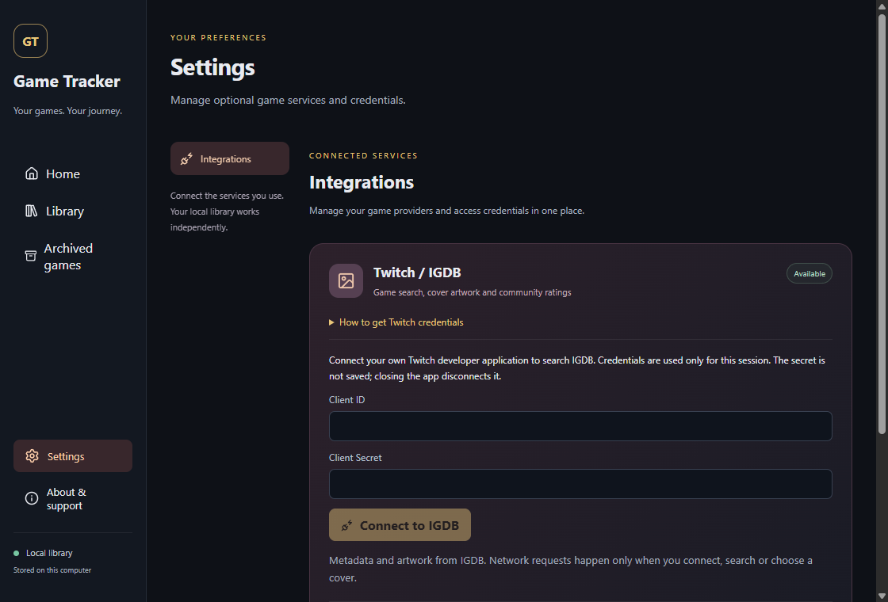

# Optional game and cover lookup

IGDB is optional. The local SQLite library, manual editing and all personal statistics work without credentials or an internet connection.

A visual, English walkthrough is included in [`website/twitch-setup.html`](../website/twitch-setup.html). The site navigation links to it as Setup guide. It is published to GitHub Pages only after this branch is reviewed, merged and passes main CI; until then, these repository instructions remain available on the branch.

## Connect locally

1. Use your own Twitch account with two-factor authentication enabled.
2. Register a **Confidential** application in the [Twitch developer console](https://dev.twitch.tv/console/apps). IGDB does not use the redirect URL; use `http://localhost` in the registration form.
3. Generate the application's Client Secret.
4. In Game Tracker, use the bottom sidebar gear to open **Settings → Integrations → Twitch / IGDB**, and enter the Client ID and Client Secret directly in the app. Never paste a secret into chat, a public issue, Git, screenshots or a browser build setting.
5. Connect. The secret is sent to Twitch over HTTPS in a form body, not a URL. Rust retains only the application ID and access token in memory for this session. Closing the app or pressing Disconnect removes that session. Reconnect when it expires.

### Registration checklist

| Twitch field       | What to enter                                                     |
| ------------------ | ----------------------------------------------------------------- |
| Name               | A unique name, for example `Game Tracker IGDB — your username`    |
| OAuth Redirect URL | `http://localhost`, then click Add                                |
| Category           | The integration category appropriate to your application          |
| Client Type        | **Confidential**, so IGDB credentials can include a Client Secret |

After creating the application, open **Applications → Manage → New Secret**. Portuguese console labels are **Aplicativos → Gerenciar → Novo segredo**, and **Confidencial** is the required client type.

**No New Secret button?** Your application may have been registered as Public. If Twitch locks the type, register a new Confidential application with a different unique name. Regenerating a secret invalidates the previous one; update the app connection when doing that.

### Where the credentials go

This example has no credentials entered. Use the desktop Settings page, not the project website, chat or a public GitHub issue.

There is deliberately no shared developer secret in the binary and no plaintext credential file. Persistent credential storage is not implemented. GitHub Pages never receives credentials. The UI clears the password field when submitting the connection request; the backend does not return tokens to the renderer or include remote response bodies in errors.

## Choose an edition

Open a game's edit popup and expand **Find a game & cover on IGDB**. Search, inspect the title, platforms and release year, then choose the correct edition. Results are limited to eight. There is no background library upload or automatic title matching.

Credentials are configured only in Settings, not in the game editor. When disconnected, the editor explains where to connect and keeps manual editing available. Steam has a clearly marked Coming soon card in Settings; no Steam key is collected until synchronization is implemented.

Choosing a result downloads its JPEG cover to the app's local `covers` directory. Save the editor to persist the IGDB link. Existing personal titles, platforms, statuses, notes, hours and ratings are preserved. New records can use the selected catalog title. Remove link in the editor to unlink metadata. Cancel does not save the association, although an already downloaded public cover may remain cached.

Selected covers are loaded lazily from disk, including when offline. Search-result thumbnails are fetched from the IGDB image CDN while the search is open. Missing, failed or unlinked covers show a neutral placeholder. No substitute artwork or fabricated scores are inserted.

## Scores, sources and usage

Personal ratings remain optional 1–5 scores. IGDB's community rating is separately labeled on a 100-point scale, with its rating count in the editor. It is a snapshot from the time you select an edition, not a continuously refreshed score. This integration does not retrieve written user reviews, scrape Steam reviews or imply endorsement by Twitch/IGDB.

IGDB metadata and artwork retain their own applicable rights; the application's AGPL license does not relicense them. The API's published terms describe non-commercial use and a separate commercial partnership process. Review the current [IGDB documentation and terms](https://api-docs.igdb.com/) before distributing a service or using shared credentials commercially.

## Network and storage boundaries

Rust uses fixed Twitch, IGDB and image-CDN endpoints, standard TLS validation, a 12-second request timeout, no redirects and bounded responses. Search inputs are escaped as literals. Requests are serialized with at least 350 ms between search starts. Authentication failures invalidate the session; rate limits ask the user to wait rather than polling. Search returns at most eight candidates. JSON responses are capped at 256 KiB; cover downloads at 2 MiB. Only validated image IDs can address the cache; arbitrary file paths and arbitrary remote image URLs are not accepted.

Schema 2 adds optional catalog fields. An existing schema-1 library is backed up next to its database before the transactional migration. Do not open the upgraded database with an older app that only supports schema 1. The application refuses newer schemas instead of downgrading them.

## Verification limits

Controlled local HTTP tests establish request shape, token isolation, rejection handling, response bounds and offline cache reads without real credentials. SQLite tests cover migration backups, metadata persistence and statistics coverage. Renderer tests cover selecting an edition without overwriting personal information, failed cover downloads and clearing the password field. A live account connection still requires the owner's own credentials and is not claimed by those tests.
